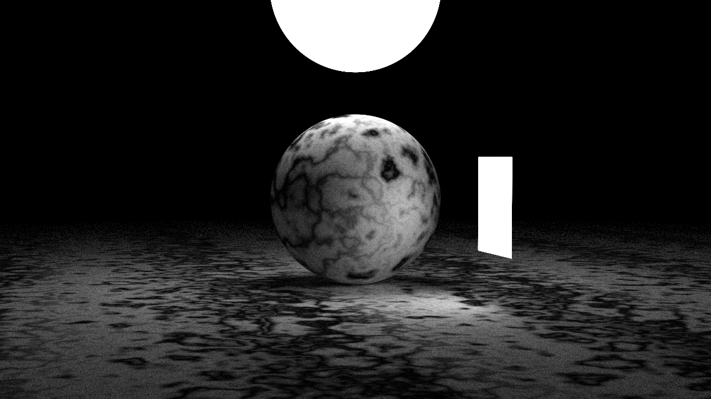
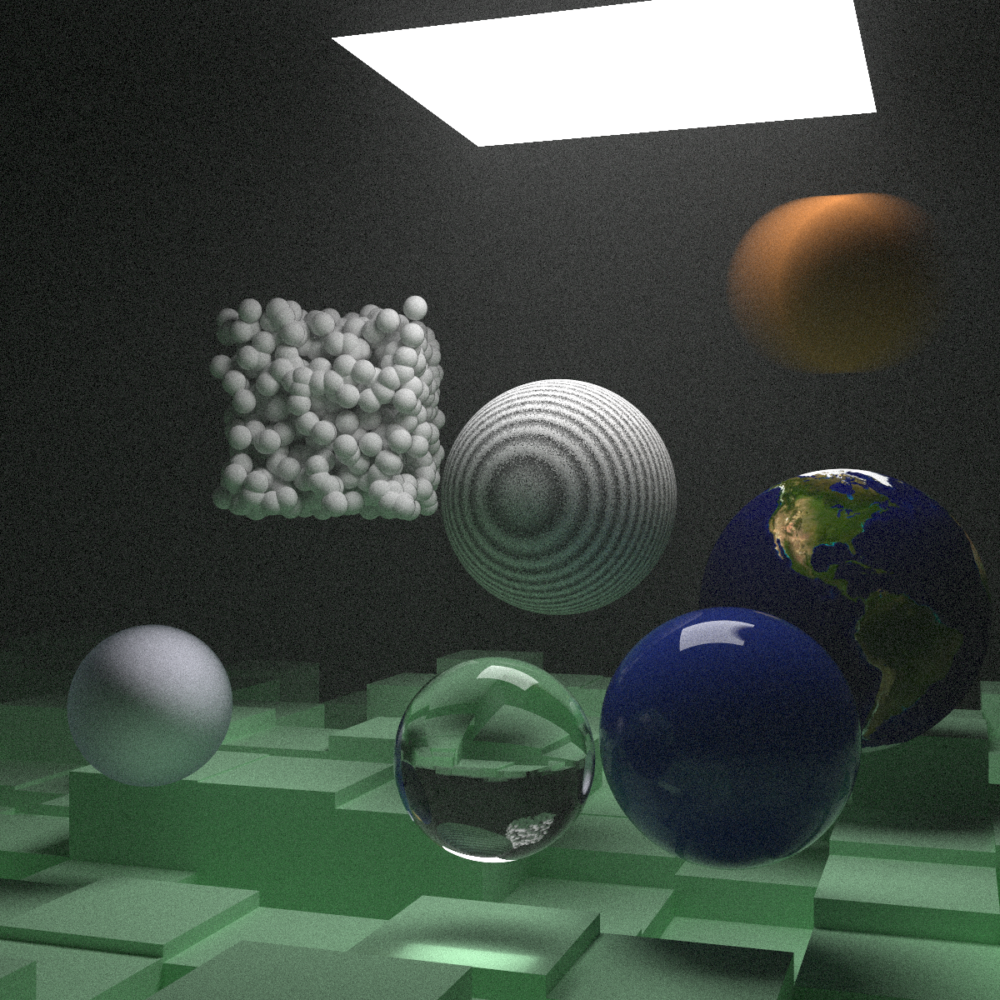

  
  
  

# Ray Tracer in C++

A custom C++ ray tracer built from scratch, following the first two books of Peter Shirley's acclaimed *"Ray Tracing in One Weekend"* series, with additional custom extensions.

## Overview

This is my first serious step into computer graphics and the largest project I've tackled so far. By building a ray tracer from the ground up, I learned how light, color, and geometry come together to create an image, implementing core graphics concepts and physics principles directly in C++.

## Features

* **Core Ray Tracing:** Implements fundamental concepts including rays, shading, and reflection.
* **Materials & Shading:** Experimented with various material types and camera settings to render realistic lighting interactions in 3D space.
* **Advanced Concepts** 
  * Optimization techniques and advanced lighting models.
  * Perlin Noise texture generation for procedural texturing.
* **OBJ Model Loading:** Extended the base project by introducing custom OBJ model loading via fan triangulation.

## Gallery
You can view some rendering I did with this project in the MixedMedia folder. 
